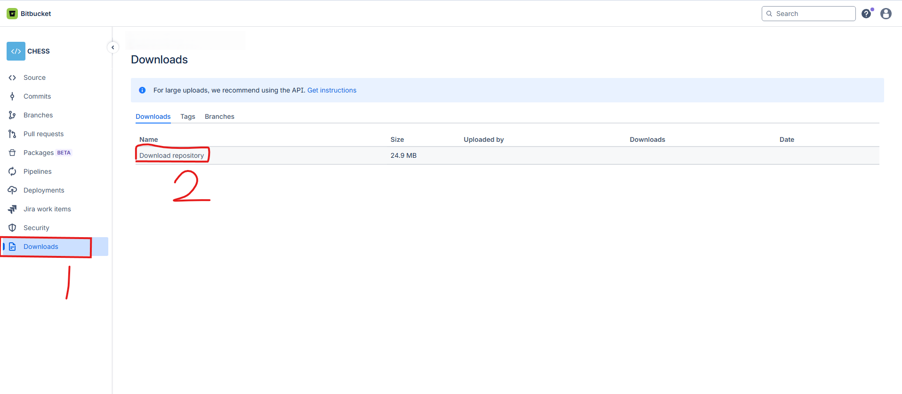
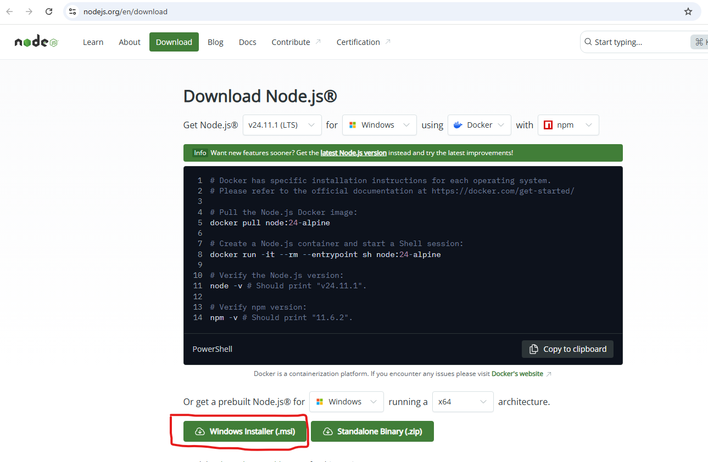

# 🛠️ Setting up the Chess Project

Node.js Version Required: **20.x or 22.x**

---

## ✅ macOS Instructions

📌 **Step 1: Install Node.js v20 or v22 on macOS**  

Since the project requires Node.js v20 or v22 and macOS does not include it by default, follow these steps to install it:

👉 https://nodejs.org/en/download 

**Screenshot for reference:**  


Open Terminal (Cmd + Space, then type Terminal and hit Enter).

Verify the Node.js and npm installation:

```bash
node -v
npm -v
```

Expected output:
```
v20.x.x or v22.x.x
x.x.x
```

---

📌 **Step 2: Download the Project**  

1. Go to the Bitbucket repo and download: 
https://bitbucket.org/solice22/chess_demo/downloads/

**Screenshot for reference:**  


2. Extract the ZIP file in **Downloads**:  

Open Terminal (Cmd + Space, then type Terminal and hit Enter).

```bash
cd ~/Downloads
unzip chess_demo.zip
```

---

📌 **Step 3: Navigate to the Project Directory**  

```bash
cd ~/Downloads/chess_demo
```

---

📌 **Step 4: Install Project Dependencies**  

```bash
npm install
```

---

📌 **Step 5: Start the Project**  

```bash
npm start
```

✅ That’s it! Your Node.js project should now be running on macOS.

---

## ✅ Windows Instructions

📌 **Step 1: Install Node.js v20 or v22 on Windows**

1. Download Node.js v20 or v22 from the official website:  

👉 https://nodejs.org/en/download 

**Screenshot for reference:**  


2. Run the installer and follow the setup wizard.  
   - Accept the license agreement.  
   - Keep the default installation settings.  
   - Make sure **“Add to PATH”** is checked.  

3. Verify installation:  
   Open Command Prompt (`Win + R` → type `cmd` → Enter) and run:
   ```bash
   node -v
   npm -v
   ```
   Expected output:  
   ```
   v20.x.x or v22.x.x
   x.x.x
   ```

---

📌 **Step 2: Download the Project**  
1. Go to the Bitbucket repo and download:  https://bitbucket.org/solice22/chess_demo/downloads


2. Extract the ZIP file by right-clicking and choosing **Extract All…**  
   This creates a folder like **chess_demo**.  

---

📌 **Step 3: Open Command Prompt in the Project Directory**  

```bash
cd %HOMEPATH%\Downloads\chess_demo
```

---

📌 **Step 4: Install Project Dependencies**  

```bash
npm install
```

---

📌 **Step 5: Start the Project**  

```bash
npm start
```

✅ That’s it! Your Node.js project should now be running on Windows.

---

## ✅ Linux (Ubuntu/Debian) Instructions

📌 **Step 1: Install Node.js v20 or v22 on Linux**

1. Update system packages:  
```bash
sudo apt update && sudo apt upgrade -y
```

2. Install prerequisites:  
```bash
sudo apt install curl build-essential -y
```

3. Install **n** (Node version manager):  
```bash
sudo npm install -g n
```

*(If npm is not installed, install Node.js from Ubuntu repo temporarily:)*  
```bash
sudo apt install nodejs npm -y
```

4. Use **n** to install Node.js v20 or v22:  
```bash
sudo n 20
# or
sudo n 22
```

5. Verify installation:  
```bash
node -v
npm -v
```

Expected output:
```
v20.x.x or v22.x.x
x.x.x
```

---

📌 **Step 2: Download the Project**  
1. Go to the Bitbucket repo and download: https://bitbucket.org/solice22/chess_demo/downloads


2. Extract the ZIP file in **Downloads**:  
```bash
cd ~/Downloads
unzip chess_demo.zip
```

---

📌 **Step 3: Navigate to the Project Directory**  

```bash
cd ~/Downloads/chess_demo
```

---

📌 **Step 4: Install Project Dependencies**  

```bash
npm install
```

---

📌 **Step 5: Start the Project**  

```bash
npm start
```

✅ That’s it! Your Node.js project should now be running on Linux.

---

## ⚠️ Troubleshooting

If your project **does not start** or you encounter **errors during setup**, try the following steps:

1. **Ensure you are using Node.js v20 or v22**
   ```bash
   node -v
   ```
   The output should start with `v20.` or `v22.`

2. **Clean and reinstall dependencies**
   ```bash
   rm -rf node_modules package-lock.json
   npm install
   npm start
   ```

3. **If the issue persists**, verify your npm version:
   ```bash
   npm -v
   ```

   Consider updating npm if it’s outdated:
   ```bash
   npm install -g npm@latest
   ```

💡 *Most issues are resolved by reinstalling dependencies or ensuring you're on Node.js v20 or v22.*

---

✅ **You’re all set!**  
If you still experience issues, please contact the project maintainer or open an issue in the Bitbucket repository.
